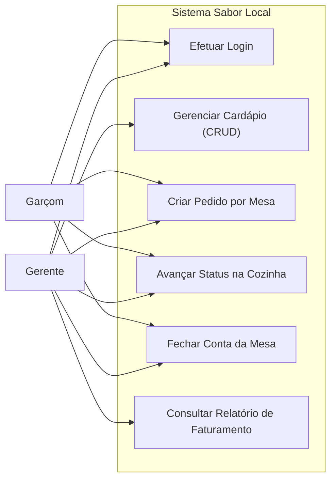
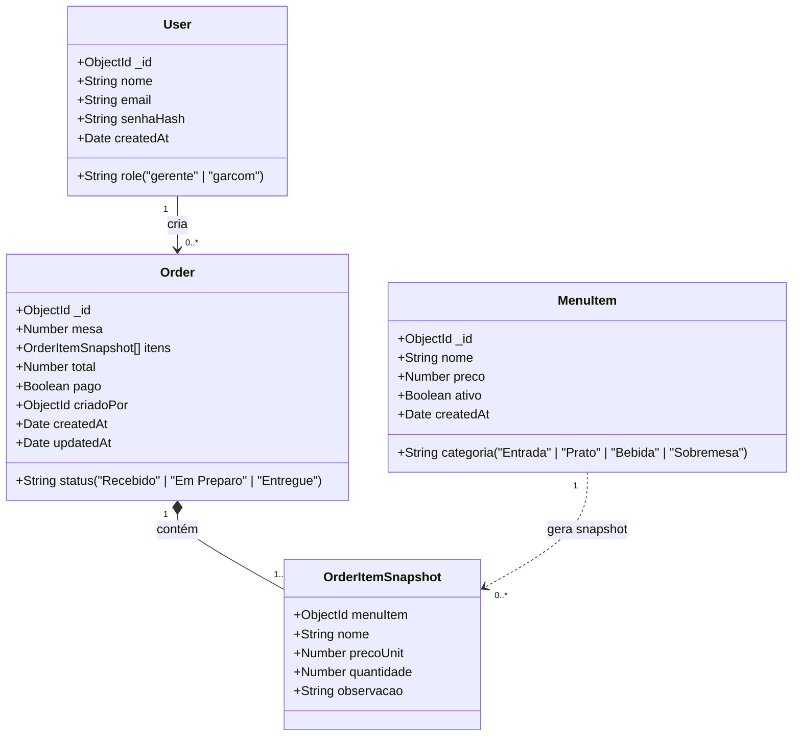
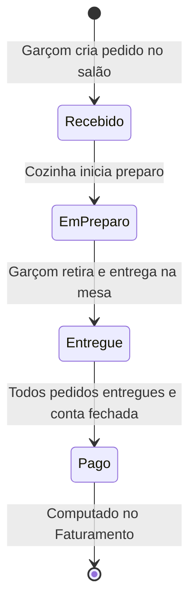

# Especificação de Requisitos de Software (SRS)
## Sistema de Gestão de Pedidos e Faturamento — Bistrô Sabor Local
**Padrão:** ISO/IEC/IEEE 29148:2018  
**Projeto:** Situação de Aprendizagem — Desenvolvimento Full-Stack (DevSolutions)  
**Cliente:** Pequeno Bistrô Sabor Local  
**Versão:** 1.0 (MVP Final)  
**Protótipo de Interface (Stitch):** [https://stitch.withgoogle.com/projects/17604261087056242602](https://stitch.withgoogle.com/projects/17604261087056242602)

---

## 1. Introdução

### 1.1 Propósito
Este documento especifica os requisitos funcionais, não-funcionais e arquiteturais do MVP (Mínimo Produto Viável) desenvolvido para o cliente **Pequeno Bistrô Sabor Local**, visando informatizar e otimizar o ciclo de vida dos pedidos do restaurante.

### 1.2 Problema de Negócio
No cenário original, os pedidos eram anotados manualmente em comandas de papel. Isso acarretava:
- Perda e extravio frequente de comandas físicas;
- Incompreensão dos itens por ilegibilidade da caligrafia;
- Falta de controle sobre a ordem de chegada (FIFO) na cozinha;
- Inconsistências na soma final das contas e impossibilidade de mensurar o faturamento diário.

### 1.3 Escopo do Produto
O sistema **Sabor Local** é uma aplicação corporativa web responsiva que centraliza a anotação de pedidos no salão, orquestra a fila de produção da cozinha em tempo real, gerencia o cardápio e consolida o faturamento diário com fechamento automatizado de mesas.

---

## 2. Descrição Geral

### 2.1 Perfis de Usuário (Atores)

| Perfil | Descrição | Permissões no Sistema |
|---|---|---|
| **Gerente** | Responsável pela gestão administrativa e financeira do bistrô. | CRUD do Cardápio, visualização de todos os pedidos, fechamento de mesas e acesso exclusivo ao **Relatório de Faturamento**. |
| **Garçom** | Responsável pelo atendimento direto no salão. | Criação de novos pedidos por mesa, acompanhamento das comandas ativas e visualização da fila da cozinha. |

### 2.2 Stack Tecnológica e Ambiente Operacional
- **Frontend / Backend:** Next.js (App Router), React, Sass/SCSS Modules.
- **Banco de Dados:** MongoDB via ODM Mongoose.
- **Segurança & Sessão:** JWT (`jsonwebtoken`) assinado no servidor, cookies HttpOnly e hash de senhas com `bcryptjs`.
- **Fuso Horário:** Horário Oficial de Brasília (`America/Sao_Paulo`) aplicado nos relatórios e agrupamentos.
- **Prototipagem:** Google Stitch ([Projeto #17604261087056242602](https://stitch.withgoogle.com/projects/17604261087056242602)).

---

## 3. Requisitos do Sistema

### 3.1 Requisitos Funcionais (RF)

| ID | Nome | Descrição | Ator |
|---|---|---|---|
| **RF01** | Autenticação por Papel (RBAC) | Permitir login via e-mail/senha emitindo token JWT armazenado em cookie seguro, direcionando o usuário conforme sua *role* (`gerente` ou `garcom`). | Todos |
| **RF02** | CRUD do Cardápio | Cadastrar, listar, editar e desativar logicamente itens com nome, categoria (*Entrada*, *Prato*, *Bebida*, *Sobremesa*) e preço. | Gerente |
| **RF03** | Anotação de Pedidos | Criar comanda associando número da mesa (>= 1) e múltiplos itens do cardápio, com quantidade e observações customizadas. | Garçom / Gerente |
| **RF04** | Snapshot Seguro de Preços | Congelar o preço e nome vigentes do item no momento do envio do pedido no backend, impedindo adulteração de valores pelo cliente. | Sistema |
| **RF05** | Fila da Cozinha (Kanban) | Exibir os pedidos em ordem cronológica de chegada (FIFO), permitindo transição de status (*Recebido* → *Em Preparo* → *Entregue*). | Garçom / Gerente |
| **RF06** | Totalização Automática | Calcular a soma dos itens e o valor global da mesa automaticamente com base nos dados do servidor. | Sistema |
| **RF07** | Fechamento de Conta da Mesa | Encerrar a conta de uma mesa cujos pedidos já foram todos entregues, marcando os pedidos como pagos (`pago = true`). | Garçom / Gerente |
| **RF08** | Relatório de Faturamento | Exibir KPIs financeiros (Total Geral, Dias com Vendas, Média Diária, Qtd. de Pedidos) e tabela agregada por dia em `pt-BR`. | Gerente |

### 3.2 Requisitos Não-Funcionais (RNF)

- **RNF01 (Segurança de API):** Todas as rotas de API devem responder status `401 Unauthorized` quando não autenticadas e `403 Forbidden` quando o usuário não tiver permissão para o recurso.
- **RNF02 (Integridade Financeira):** Nenhum valor monetário de item é aceito diretamente a partir do payload do frontend; a busca e gravação de preços são estritamente executadas via banco de dados.
- **RNF03 (Responsividade):** A interface deve ser plenamente utilizável em smartphones/tablets utilizados pelos garçons no salão e em telas desktop de gerência.
- **RNF04 (Regra de Encerramento):** A conta de uma mesa só pode ser fechada quando 100% dos seus pedidos estiverem com o status `Entregue`.
- **RNF05 (Fuso Horário Fidedigno):** O faturamento diário deve ser agrupado no fuso horário `America/Sao_Paulo` via pipeline de agregação do MongoDB.

---

## 4. Modelagem do Sistema

### 4.1 Diagrama de Casos de Uso


### 4.2 Modelo de Dados (Entidades)


### 4.3 Ciclo de Vida do Pedido e Mesa


### 4.4 Protótipo de Interface (UI/UX)
Os fluxos de telas, layout responsivo e diretrizes visuais do projeto foram prototipados utilizando o **Google Stitch**:
- **Link do Protótipo:** [https://stitch.withgoogle.com/projects/17604261087056242602](https://stitch.withgoogle.com/projects/17604261087056242602)

---

## 5. Instruções de Instalação e Execução

### 5.1 Pré-requisitos
- Node.js >= 20.x
- Instância do MongoDB rodando em `127.0.0.1:27017`

### 5.2 Configuração de Ambiente
Criar o arquivo `.env.local` na raiz:
```env
MONGODB_URI=mongodb://127.0.0.1:27017/sabor_local
JWT_SECRET=sua_chave_secreta_jwt_super_segura_2026
```

### 5.3 Carga Inicial de Dados (Seed)
Popula os usuários padrão e pratos iniciais:
```bash
npm run seed
```

**Credenciais de Acesso (senha: `123456`):**
- **Gerente:** `gerente@bistro.com`
- **Garçom:** `garcom@bistro.com`

### 5.4 Execução da Aplicação
```bash
# Modo de desenvolvimento
npm run dev

# Build de produção
npm run build

# Execução em produção
npm run start
```
Acesse em: [http://localhost:3000](http://localhost:3000)

---

## 6. Mapeamento de Rotas da Solução

| Rota | Tipo | Papel Mínimo | Descrição |
|---|---|---|---|
| `/login` | Página | Público | Formulário de autenticação segura |
| `/pedidos` | Página | Garçom / Gerente | Listagem com filtros e fechamento de mesas |
| `/pedidos/novo` | Página | Garçom / Gerente | Anotação de comanda |
| `/cozinha` | Página | Garçom / Gerente | Gestão visual do fluxo de preparo |
| `/cardapio` | Página | Gerente | Painel de controle do cardápio |
| `/faturamento` | Página | Gerente | Dashboard de KPIs e histórico diário |
| `/api/auth/*` | API REST | Variável | Endpoints de login, logout e sessão |
| `/api/menu/*` | API REST | Gerente (escrita) | CRUD de itens com controle de ativação |
| `/api/orders/*` | API REST | Garçom / Gerente | Gerenciamento de pedidos e transição de status |
| `/api/mesas/:mesa/fechar` | API REST | Garçom / Gerente | Fechamento de conta e quitação |
| `/api/reports/revenue` | API REST | Gerente | Agregação `$match`, `$group` e `$sort` de receita |
